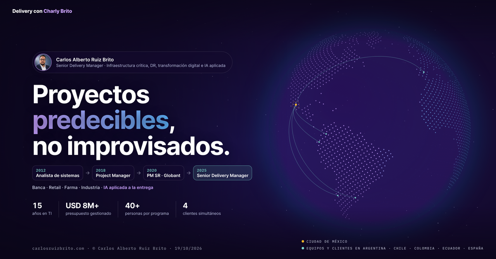
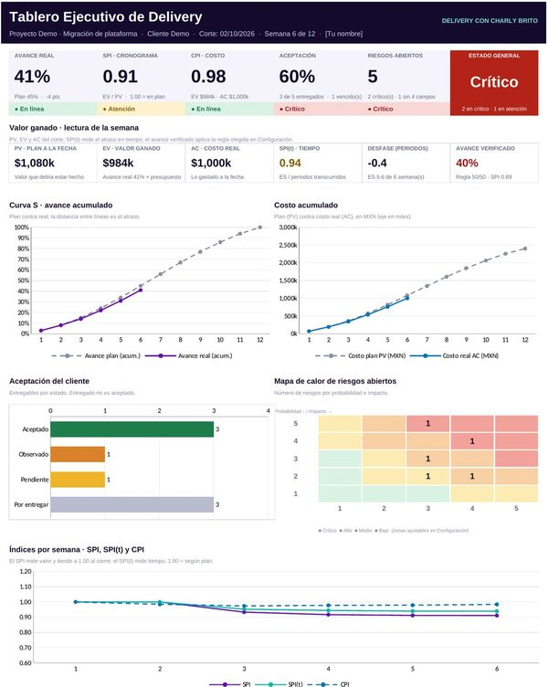

<!-- © Carlos Alberto Ruiz Brito · Delivery con Charly Brito · carlosruizbrito.com · 17/11/2026 -->

### Hola, soy Carlos Alberto Ruiz Brito

Senior Delivery Manager. Dirijo portafolios de infraestructura crítica, Disaster Recovery y transformación digital con un objetivo: proyectos predecibles, no improvisados.

- **15 años en TI** · banca, retail, farma, automotriz, educación e industria
- **Programas de 40+ personas** y hasta 4 clientes simultáneos, con equipos en México, Argentina, Chile, Colombia, Ecuador y España
- **IA aplicada a la entrega:** reportes, QA y documentación con Claude, ChatGPT y Antigravity. La IA propone; la persona valida y decide.

### De qué escribo · #DeliveryConCharlyBrito

| Tema | Enfoque |
|---|---|
| Delivery Management | Gobierno de entrega, métricas, documentos clave y reportes ejecutivos |
| Infraestructura y continuidad | Migraciones, centros de datos, Disaster Recovery y cambios en sistemas 24x7 |
| IA aplicada a la entrega | Reportes, QA y documentación con revisión humana |
| Liderazgo | Equipos multipaís, comunicación con dirección y escalación con criterio |

### Recursos gratuitos (CC BY 4.0)

**[Tablero Ejecutivo de Delivery](https://carlosruizbrito.com/recursos/tablero-ejecutivo.html)** · Excel en español e inglés
Avance, SPI, CPI, aceptación del cliente y riesgos en una página, con semáforo automático y video de uso.

Próximos: registro de riesgos y checklist de cambio en sistemas 24x7. Catálogo completo en **[carlosruizbrito.com/recursos](https://carlosruizbrito.com/recursos/)**.

 

### Contacto

**Sitio:** [carlosruizbrito.com](https://carlosruizbrito.com) · **LinkedIn:** [linkedin.com/in/carlosruizb](https://www.linkedin.com/in/carlosruizb) · **Correo:** carlos@carlosruizbrito.com

---

<b>English</b>

### Hi, I'm Carlos Alberto Ruiz Brito

Senior Delivery Manager. I run critical infrastructure, Disaster Recovery and digital transformation portfolios with one goal: predictable projects, not improvised ones.

- **15 years in IT** · banking, retail, pharma, automotive, education and industrial clients
- **Programs of 40+ people** and up to 4 concurrent clients, with teams in Mexico, Argentina, Chile, Colombia, Ecuador and Spain
- **AI applied to delivery:** reporting, QA and documentation with Claude, ChatGPT and Antigravity. AI proposes; people validate and decide.

**Free resources (CC BY 4.0):** [Executive Delivery Dashboard](https://carlosruizbrito.com/recursos/tablero-ejecutivo.html), Excel in English and Spanish. Full catalog at [carlosruizbrito.com/recursos](https://carlosruizbrito.com/recursos/).

**Website:** [carlosruizbrito.com](https://carlosruizbrito.com) · **LinkedIn:** [linkedin.com/in/carlosruizb](https://www.linkedin.com/in/carlosruizb)

© 2026 Carlos Alberto Ruiz Brito · Delivery con Charly Brito · Las opiniones y recursos son personales y educativos; no representan a empleadores, clientes ni fabricantes.
